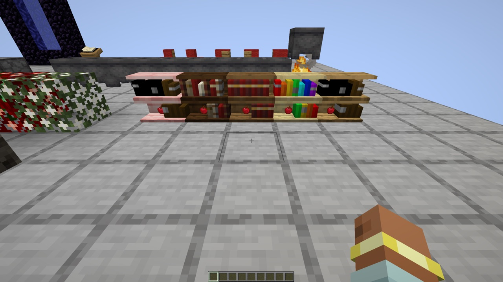
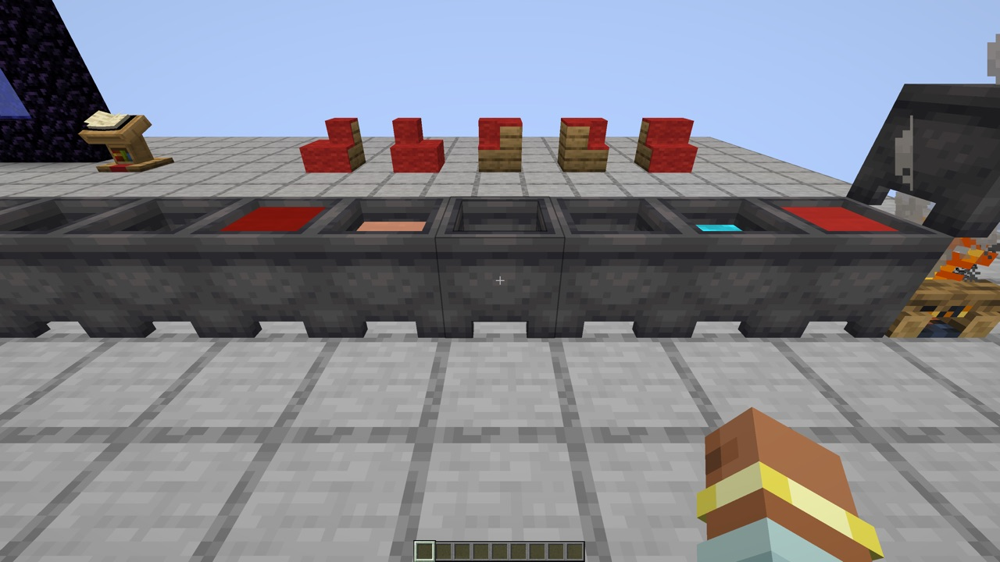
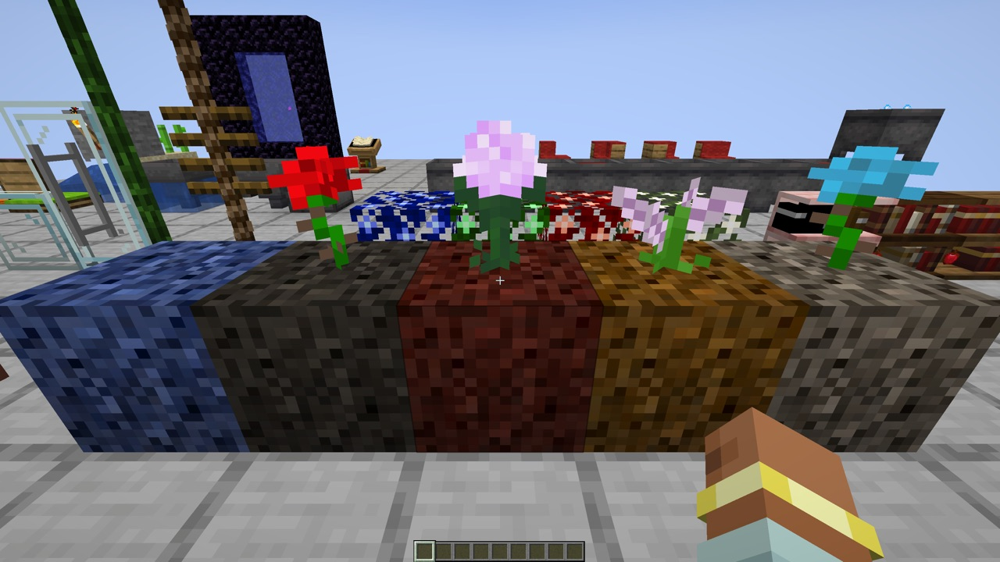
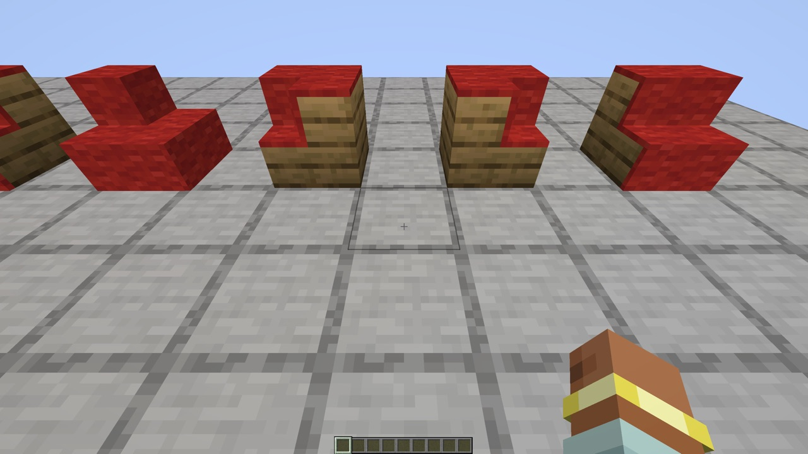
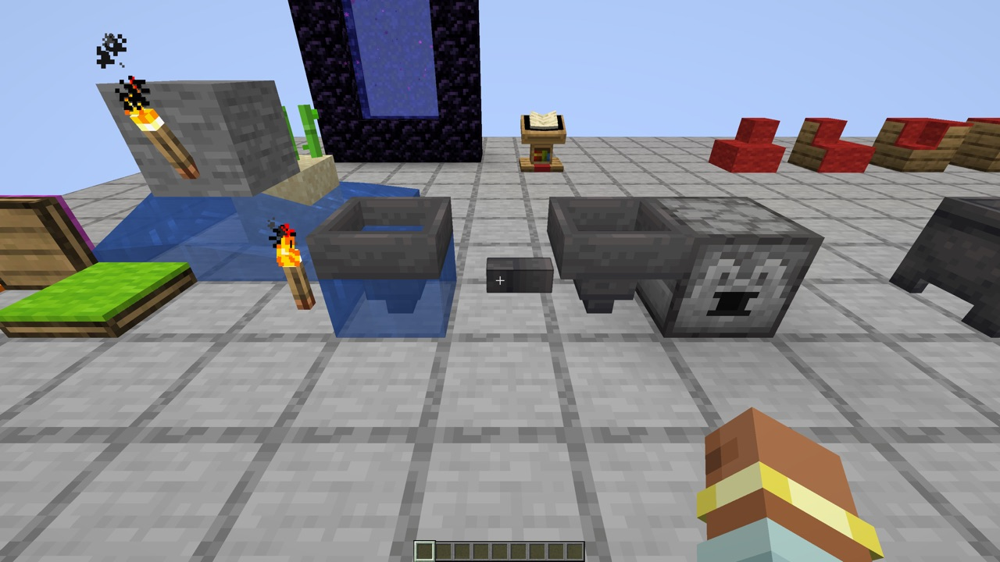
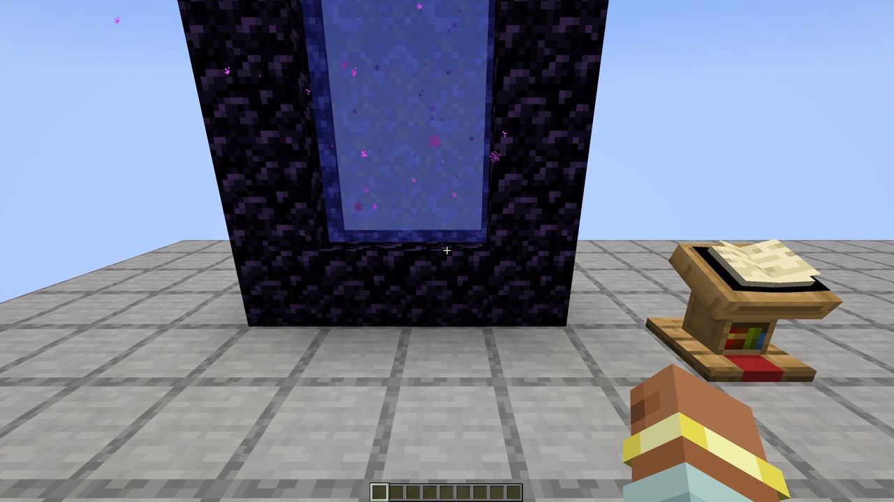

# Inspirations — NeoForge 1.21.1

**Shelves, ropes, colored books, cauldrons full of soup and dye, redstone tools and many small vanilla tweaks — now on Minecraft 1.21.1.**

An unofficial port of **[Inspirations](https://www.curseforge.com/minecraft/mc-mods/inspirations)** 1.5.0 by
**KnightMiner** from Minecraft 1.20.1 (Forge) to **NeoForge 1.21.1**, with all of its content.

<b>🇬🇧 English — click to open</b>

## Download

| Version | Minecraft | Loader | Java |
| --- | --- | --- | --- |
| 1.5.0+1.21.1 | 1.21.1 | NeoForge 21.1.197 or newer | 21 |

Releases: [GitHub releases](../../releases).

## Installation

- **Singleplayer:** put the jar into `mods/` of a NeoForge 1.21.1 instance.
- **Server:** put the same jar into `mods/` of the server **and** of every client.
- **Nothing else to install.** The original needs the library Mantle by SlimeKnights, which has no release for
  Minecraft 1.21. This port uses [Kilnwork](https://github.com/Vladeezyy/kilnwork) instead, a library built from the
  parts of Mantle that Inspirations needs, and it ships inside the jar.
- [JEI](https://www.curseforge.com/minecraft/mc-mods/jei) is optional: it shows every texture of shelves and bushes.

## Features

Everything is split into five modules, and every feature can be turned off in `config/inspirations-common.toml`
(registration, needs a restart) or `inspirations-server.toml` (behavior).

- **Building:** shelves that take the texture of any slab and show the books and items put on them (and power
  enchanting tables), colored books, rope and vine rope (climbable, with rungs), climbable iron bars over a rope, glass
  doors and trapdoors, mulch in five colors, stone paths, roses, syringa, paeonia and cyan flowers from shearing double
  flowers, enlightened bushes.
- **Utility:** collector (a hopper that faces any way and picks up items in front of it), pipe (a cheap hopper that only
  pushes), torch levers, carpeted trapdoors and pressure plates, trapped book (a comparator signal from a shelf),
  dispensers that fill and empty tanks.
- **Tools:** locks and keys for containers, redstone charger and charged arrows (a short redstone pulse where they
  land), north compass, barometer, photometer, dimension compass; shields that take protection, thorns, knockback and
  fire aspect, axes that take looting, knockback and fire aspect.
- **Tweaks:** carpets that fit to stairs, waterlogged hoppers, cactus and sugar cane seeds with smooth growth, heartbeets,
  more bonemeal uses, pig desaddling, lily pads that break a fall, skeleton skulls and cave spider webs as rare drops,
  colored portals, tinted lectern books, colored firework and enchanted book items, milk cooldown (off by default).
- **Cauldrons:** boiling water over fire, cauldrons of dye, potions, milk, honey and five soups and stews; dye and wash
  items, brew potions and tip arrows in the cauldron, splash and lingering bottles.

## Fixed in this port

Open issues of the original and bugs found while porting:

| | |
| --- | --- |
| [#247](https://github.com/KnightMiner/Inspirations/issues/247) | Shelves in the creative tab used planks, the recipe uses slabs, so JEI showed no recipe for them |
| [#227](https://github.com/KnightMiner/Inspirations/issues/227) | Two collectors could pick up the same dropped item and duplicate it |
| [#245](https://github.com/KnightMiner/Inspirations/issues/245), [#250](https://github.com/KnightMiner/Inspirations/issues/250) | Crashes with mods that change cauldrons or iron bars, caused by the original's registry substitutions: the port changes the vanilla blocks with mixins instead, and each change can still be turned off |
| [#226](https://github.com/KnightMiner/Inspirations/issues/226) | Honey is in the `c:honey` fluid tag |
| — | Crash: block colors and shelf models were cached in plain hash maps read by many chunk builder threads at once |
| — | The shelf could not be turned off: the config keys `building.bookshelf` and `building.bookshelf.enable` collide (now `building.shelf`) |
| — | Skeleton skull, cave spider web and flower drops were never added: their loot listeners were not registered |
| — | Shearing vines worked the wrong way round; dispensers placing anvils also dropped them |
| — | Lectern book requests were answered for any position of the world |
| — | Potion clouds applied their effects twice; shelf screens could open without a shelf |
| — | Missing names: potted flowers, rabbit stew cauldron (typo in the key), fitted carpets and wet hopper in Jade |

Checked and not changed: [#251](https://github.com/KnightMiner/Inspirations/issues/251) (ModernFix: no error in
our run with ModernFix), [#244](https://github.com/KnightMiner/Inspirations/issues/244) and
[#237](https://github.com/KnightMiner/Inspirations/issues/237) (1.19 crashes, fixed in 1.20 already),
[#231](https://github.com/KnightMiner/Inspirations/issues/231) (the recipe follows the config),
[#236](https://github.com/KnightMiner/Inspirations/issues/236) (not reproduced), the feature requests.

## Worlds from 1.20.1

Shelves, enlightened bushes, cauldrons and the items in them carry over: the textures, items, colors, potions and
suspicious stew effects of 1.20 worlds are read and converted. The position of the dimension compass of 1.20 players is
not carried over (it is set again on the next dimension change).

## Languages

English, Russian, Ukrainian, German, Spanish, Brazilian Portuguese and Chinese (Simplified).

## License

The port's code is [LGPL-3.0-only](LICENSE). The original is MIT, its license is kept in
[licenses/LICENSE-MIT](licenses/LICENSE-MIT). The textures `books_ancient.png` and `books_tomes.png` are
CC BY-NC-SA 4.0 ([licenses/TEXTURE_LICENSE.md](licenses/TEXTURE_LICENSE.md)). All license texts are inside the jar.

## Credits

- **KnightMiner** — the original mod.
- [/u/nox-cgt](https://www.reddit.com/user/nox-cgt) — heartbeet idea and texture, [/u/TheTrone](https://www.reddit.com/user/TheTrone) — syringa texture,
  [TimGoll](https://github.com/TimGoll) — carpeted trapdoor texture (credits of the original).
- Port: Vladeezyy. How it was ported and tested: [PORTLOG.md](PORTLOG.md).

<b>🇷🇺 Русский — нажмите, чтобы открыть</b>

## Скачать

| Версия | Minecraft | Загрузчик | Java |
| --- | --- | --- | --- |
| 1.5.0+1.21.1 | 1.21.1 | NeoForge 21.1.197 или новее | 21 |

Релизы: [GitHub releases](../../releases).

## Установка

- **Одиночная игра:** положите jar в `mods/` сборки NeoForge 1.21.1.
- **Сервер:** тот же jar — в `mods/` сервера **и** каждого клиента.
- **Больше ничего не нужно.** Оригиналу нужна библиотека Mantle от SlimeKnights, у которой нет версии для Minecraft
  1.21. Порт использует [Kilnwork](https://github.com/Vladeezyy/kilnwork) — библиотеку из тех частей Mantle, что нужны
  Inspirations, и она уже внутри jar.
- [JEI](https://www.curseforge.com/minecraft/mc-mods/jei) по желанию: показывает все текстуры полок и кустов.

## Возможности

Всё разбито на пять модулей, любую возможность можно выключить в `config/inspirations-common.toml` (регистрация,
нужен перезапуск) или `inspirations-server.toml` (поведение).

- **Строительство:** полки с текстурой любой плиты, на которых видны книги и предметы (и которые усиливают стол
  зачарования), цветные книги, верёвка и верёвка из лиан (по ним можно лазить, есть перекладины), железные решётки над
  верёвкой как лестница, стеклянные двери и люки, мульча пяти цветов, каменные тропинки, роза, сирень, пион и голубой
  цветок со стрижки двойных цветов, освещённые кусты.
- **Утилиты:** сборщик (воронка в любую сторону, подбирает предметы перед собой), труба (дешёвая воронка, только
  выталкивает), факелы-рычаги, люки и нажимные плиты под ковром, книга-ловушка (сигнал компаратору с полки),
  раздатчики, наполняющие и опустошающие баки.
- **Инструменты:** замки и ключи для контейнеров, зарядник красного камня и заряженные стрелы (короткий импульс там, где
  попали), северный компас, барометр, фотометр, компас измерений; щиты с защитой, шипами, отдачей и заговором огня,
  топоры с добычей, отдачей и заговором огня.
- **Твики:** ковры по ступенькам, затопляемые воронки, семена кактуса и тростника с плавным ростом, свёкла-сердце,
  новые применения костной муки, снятие седла со свиньи, кувшинки смягчают падение, черепа скелетов и паутина с пещерных
  пауков как редкий дроп, цветные порталы, цветные книги на кафедре, цвет фейерверков и зачарованных книг, кулдаун
  дойки (по умолчанию выключен).
- **Котлы:** кипящая вода над огнём, котлы с красителем, зельями, молоком, мёдом и пятью супами; окраска и стирка
  предметов, варка зелий и обработка стрел в котле, пузырьки для взрывных и туманных зелий.

## Исправлено в порте

Открытые issues оригинала и баги, найденные при порте:

| | |
| --- | --- |
| [#247](https://github.com/KnightMiner/Inspirations/issues/247) | Полки во вкладке творчества были из досок, а рецепт — из плит, поэтому JEI не показывал для них рецепт |
| [#227](https://github.com/KnightMiner/Inspirations/issues/227) | Два сборщика могли подобрать один и тот же предмет и задюпать его |
| [#245](https://github.com/KnightMiner/Inspirations/issues/245), [#250](https://github.com/KnightMiner/Inspirations/issues/250) | Краши с модами, меняющими котлы и железные решётки, из-за подмен реестра в оригинале: порт меняет ванильные блоки миксинами, и каждое изменение по-прежнему выключается в конфиге |
| [#226](https://github.com/KnightMiner/Inspirations/issues/226) | Мёд в теге жидкостей `c:honey` |
| — | Краш: цвета блоков и модели полок кэшировались в обычных HashMap, которые одновременно читают потоки сборки чанков |
| — | Полку нельзя было выключить: ключи конфига `building.bookshelf` и `building.bookshelf.enable` конфликтуют (теперь `building.shelf`) |
| — | Дроп черепов скелетов, паутины пещерных пауков и цветов не добавлялся: их обработчики лута не были зарегистрированы |
| — | Стрижка лиан работала наоборот; раздатчик, ставящий наковальню, ещё и выбрасывал её |
| — | Сервер отвечал на запрос книги кафедры для любой позиции мира |
| — | Облака зелий накладывали эффекты дважды; экран полки мог открыться без полки |
| — | Не было названий: цветы в горшках, котёл с тушёным кроликом (опечатка в ключе), ковры по ступенькам и мокрая воронка в Jade |

Проверено и не менялось: [#251](https://github.com/KnightMiner/Inspirations/issues/251) (ModernFix: в нашем прогоне с
ModernFix ошибок нет), [#244](https://github.com/KnightMiner/Inspirations/issues/244) и
[#237](https://github.com/KnightMiner/Inspirations/issues/237) (краши 1.19, исправлены ещё в 1.20),
[#231](https://github.com/KnightMiner/Inspirations/issues/231) (рецепт следует конфигу),
[#236](https://github.com/KnightMiner/Inspirations/issues/236) (не воспроизводится), пожелания новых возможностей.

## Миры с 1.20.1

Полки, освещённые кусты, котлы и предметы в них переносятся: текстуры, предметы, цвета, зелья и эффекты загадочного
рагу из миров 1.20 читаются и конвертируются. Позиция компаса измерений игроков 1.20 не переносится (она запишется
заново при следующей смене измерения).

## Языки

Английский, русский, украинский, немецкий, испанский, бразильский португальский и китайский (упрощённый).

## Лицензия

Код порта — [LGPL-3.0-only](LICENSE). Оригинал под MIT, его лицензия лежит в
[licenses/LICENSE-MIT](licenses/LICENSE-MIT). Текстуры `books_ancient.png` и `books_tomes.png` — CC BY-NC-SA 4.0
([licenses/TEXTURE_LICENSE.md](licenses/TEXTURE_LICENSE.md)). Все тексты лицензий есть внутри jar.

## Авторы

- **KnightMiner** — оригинальный мод.
- [/u/nox-cgt](https://www.reddit.com/user/nox-cgt) — идея и текстура свёклы-сердца, [/u/TheTrone](https://www.reddit.com/user/TheTrone) — текстура сирени,
  [TimGoll](https://github.com/TimGoll) — текстура люка с ковром (из оригинала).
- Порт: Vladeezyy. Как портировали и проверяли: [PORTLOG.md](PORTLOG.md).

